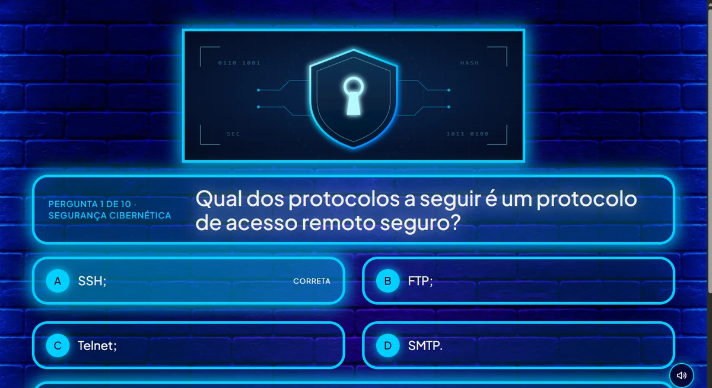

# 🧠 CyberQuiz

Quiz de **segurança cibernética** e **inteligência artificial**: o jogador digita o nome, responde 10 perguntas sorteadas de um banco de 100 e recebe o placar, o tempo, uma explicação com a fonte de cada resposta e o **ranking** dos jogadores.

Tem efeitos sonoros e música ambiente — os dois **sintetizados no navegador** (nenhum arquivo de áudio), com volume ajustável no botão de configurações no canto da tela.

Projeto integrado de **Desenvolvimento Frontend**, **Modelagem de Banco de Dados** e **Algoritmos e Pensamento Computacional** — apresentado na Mostra de Tecnologia.

<p align="center">
  <a href="https://sousaonix.github.io/cyberquiz/">
    
  </a>
</p>

🔗 **Jogue online:** <https://sousaonix.github.io/cyberquiz/>

---

## Como funciona

```
┌──────────────────────────┐
│  Navegador (HTML/CSS/JS) │  GitHub Pages  ·  estático, sem build
└────────────┬─────────────┘
             │  GET /perguntas  (JSON)
             ▼
┌──────────────────────────┐
│  API Node.js (http puro) │  Render  ·  sem framework, rotas na mão
└────────────┬─────────────┘
             │  @supabase/supabase-js
             ▼
┌──────────────────────────┐
│  PostgreSQL              │  Supabase  ·  tabelas + views do MER
└──────────────────────────┘
```

O quiz pede as perguntas para a API. Se a API estiver fora do ar ou demorar
mais de 5 segundos, ele **cai automaticamente para o `questoes.json` local** —
o jogo nunca fica na mão na frente do público.

---

## Estrutura do repositório

O site fica na **raiz** porque é de lá que o GitHub Pages publica. Todo o resto está agrupado por assunto.

```
cyberquiz/
├── index.html          ← o jogo (publicado pelo Pages)
├── css/ js/ assets/
├── questoes.json       ← banco offline de reserva
├── api/                ← backend Node.js
├── supabase/           ← SQL pronto para instalar o banco
├── docs/               ← documentação e MER
├── scripts/            ← gerador do SQL de instalação
├── tests/              ← testes da lógica
└── render.yaml         ← deploy da API
```

| Caminho | O que é |
| --- | --- |
| `index.html` | Telas de entrada, pergunta, resultado e ranking |
| `css/styles.css` | Visual neon, um tema de cor por pergunta |
| `js/quiz.js` | Interação, nome do jogador, cronômetro, API e ranking |
| `js/session.js` | Sorteio da rodada, placar e formatação do tempo |
| `js/sound.js` | Efeitos sonoros e música ambiente sintetizados (Web Audio API) |
| `js/config.js` | Endereço da API |
| `questoes.json` | Banco local usado no modo offline |
| `assets/` | Logo, mascotes, fundos (WebP) e ilustrações por categoria (SVG) |
| `api/` | Backend Node.js (`node:http` puro, sem framework) |
| `supabase/` | `setup.sql` (instala tudo) e `reset.sql` (limpa antes de reinstalar) |
| `docs/` | Documentação do banco (`01`–`08`), MER em PNG/SVG e dicionário |
| `scripts/` | `build-sql.mjs`, que gera o `supabase/setup.sql` |
| `tests/` | Testes da lógica da rodada |
| `render.yaml` | Blueprint de deploy da API no Render |
| `.github/workflows/keepalive.yml` | Ping periódico para a API não dormir |

---

## Rodando na sua máquina

### Frontend

```bash
npx serve .      # ou: python -m http.server 8000
```

Abra o endereço mostrado. Para usar um backend local em vez do publicado:

```
http://localhost:8000/?api=http://localhost:3000
```

Para forçar o modo offline (só o `questoes.json`): `?api=`.

### API

```bash
cd api
npm install
cp .env.example .env    # preencha SUPABASE_URL e SUPABASE_KEY
npm run dev             # http://localhost:3000
```

Rotas: `GET /` · `GET /health` · `GET /perguntas` · `GET /perguntas/:id` ·
`GET /categorias` · `GET /ranking` · `POST /respostas` (grava a rodada e devolve o ranking)

Filtros: `/perguntas?categoria=Inteligência Artificial` · `/perguntas?limite=10`

### Testes

```bash
npm test                # lógica do frontend (tests/)
npm run test:api        # rotas da API, com banco falso (api/test/)
```

---

## Banco de dados

O esquema segue o **MER (notação Chen)** e o contrato de nomes acordado com a
disciplina de Web. O diagrama está em [`docs/CyberQuiz_MER_Chen.png`](docs/CyberQuiz_MER_Chen.png)
e a documentação completa em [`docs/banco-de-dados.md`](docs/banco-de-dados.md).

No **SQL Editor do Supabase**, rode **um único arquivo**:

| Arquivo | O que faz |
| --- | --- |
| [`supabase/setup.sql`](supabase/setup.sql) | Cria o esquema, carrega as 100 perguntas e cria as views da API |
| [`supabase/reset.sql`](supabase/reset.sql) | Só quando precisar reinstalar: apaga os objetos do CyberQuiz |
| [`supabase/limpar-ranking.sql`](supabase/limpar-ranking.sql) | Zera jogadores e pontuações, mantendo as 100 perguntas |

Se preferir rodar por partes, os arquivos originais estão em `docs/`
(`04-ddl.sql`, `07-seed-questoes.sql`, `08-views-api.sql`), nessa ordem.

> `docs/05-dml-consultas.sql` e `docs/06-testes.sql` são a **massa de teste da
> disciplina de Banco de Dados**. Não rode no Supabase: eles acrescentariam
> perguntas de exemplo no meio das perguntas reais.

---

## Publicando (passo a passo)

1. **Supabase** — crie o projeto, rode o `supabase/setup.sql` e copie
   `Project URL` + `service_role key` (Settings → API).
2. **Render** — *New +* → *Blueprint* → escolha este repositório. O
   `render.yaml` cria o serviço `cyberquiz-api` sozinho; depois preencha
   `SUPABASE_URL` e `SUPABASE_KEY` em *Environment*.
3. **GitHub Pages** — *Settings* → *Pages* → *Deploy from a branch* →
   `main` / `/ (root)`.
4. **Conectar os dois** — coloque a URL do Render em `js/config.js`
   (`API_URL`). Enquanto não colocar, o site funciona com o banco local.
5. **Evitar a soneira do Render** — rode uma vez o workflow
   *Manter a API acordada* em *Actions* (ou abra `/health` 5 minutos antes de
   apresentar).

---

## Tecnologias

HTML5 · CSS3 (variáveis, grid, `clamp`) · JavaScript ES Modules (sem framework)
· Web Audio API (sons gerados no navegador, sem arquivo de áudio) ·
Node.js (`node:http`, sem Express) · PostgreSQL 13+ · Supabase · Render ·
GitHub Pages · WebP (14,9 MB → 1,1 MB de imagens) · `node --test`

---

## Equipe

Projeto do **CyberQuiz** — segurança cibernética e IA.
*Equipe: <preencher>* · *Orientação: <preencher>*
